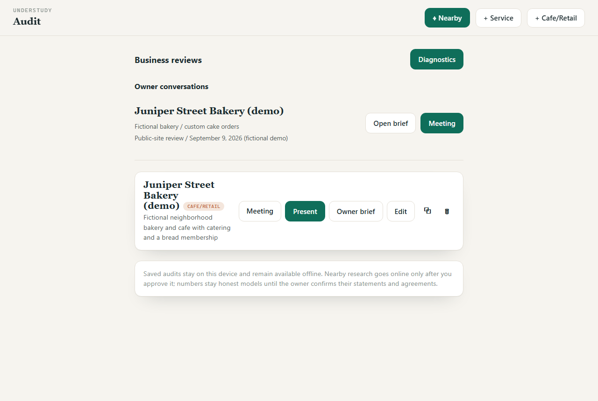
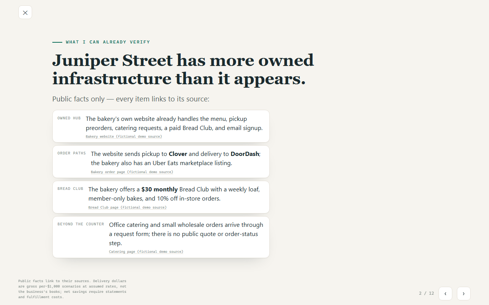
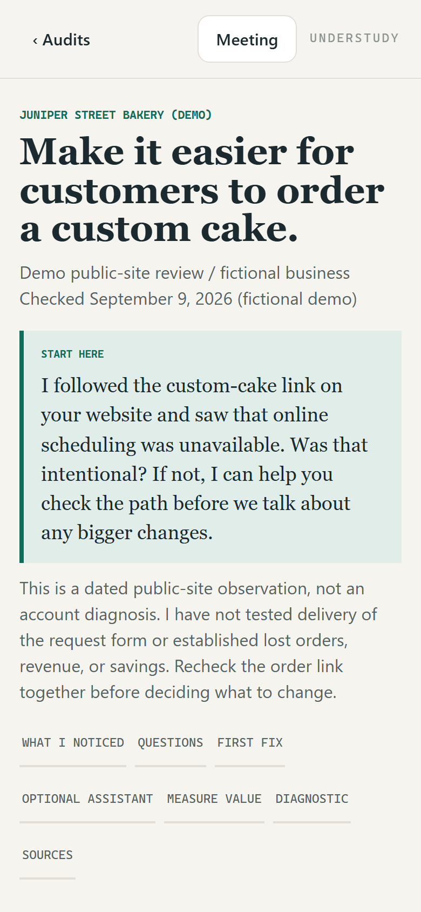

# Understudy Audit

An installable, offline web app for preparing and running a small-business systems review: research notes, a presentation deck, a meeting workspace, and a client summary that can only contain evidence-backed findings.



| Presentation deck: every public fact links to its source | Phone view of a prepared owner brief |
| --- | --- |
|  |  |

The app ships with one fictional business, **Juniper Street Bakery (demo)**. Its facts, prices and links are invented (the links use the reserved `.example` domain) so every screen can be shown without naming or researching a real company.

## Why it is interesting

The app is used in front of a business owner, on a phone, often without a reliable connection. That shaped three design rules:

1. **The data stays on the device.** Audits and meeting notes live in the browser's `localStorage`. There is no account, no backend for saved data and no sync.
2. **Nothing goes online without consent.** The one networked feature (Nearby research) sits behind an explicit consent screen, sends a rounded location, and refuses plain-HTTP endpoints.
3. **A client export cannot carry private notes or unproven claims.** The summary is built by an explicit projection that whitelists fields, and a finding can only be exported if it has a dated public source or a recorded owner confirmation.

## Architecture

```
audit-app.html      Single-page app: router, audit editor, deck, owner briefs, Nearby screens, demo seed data
meetings.js         Meeting records: validation, revision-checked saves, evidence gate, client-summary projection
meeting-ui.js       Meeting workspace UI (tabs, findings, summary preview, copy/download/print, private backup)
discovery.js        Nearby research client: consent, rounded location, HTTPS-only requests to the research service
sw.js               Service worker: offline app shell
index.html          Redirects to audit-app.html (keeps any #/route)
manifest.webmanifest, icons/   PWA install metadata
test/               node:test suites for meetings.js, discovery.js and sw.js
```

- **No build step and no dependencies.** Plain HTML, CSS and JavaScript. `meetings.js` and `discovery.js` attach to `globalThis` in the browser and also export themselves for Node so the tests can `require` them.
- **Offline PWA.** `sw.js` pre-caches the app shell on install. Navigations to `audit-app.html` are network-first and refresh the cached shell; any other page in scope (the index redirect, a 404) is passed through and never written into that cache. Offline, navigations fall back to the cached shell. Static assets are cache-first.
- **Local-only data.** Audits are stored under `understudy_audit_v1`; each meeting record under `understudy_diagnostic_v1:<id>`; discovery settings and consent under their own keys. Clearing site data removes everything.
- **Consented research service.** Nearby search and public-website research call a separate Cloudflare Worker (`POST /v1/places`, `POST /v1/research`) that uses Geoapify / OpenStreetMap place data. The Worker requires an access code sent as the `X-Understudy-Access` header. Its source is not part of this repository.

## Privacy by design (where to look in the code)

| Guarantee | Code |
| --- | --- |
| Discovery shows a consent screen before any location request or network call | `discoveryConsent()` and `renderDiscover()` in [`audit-app.html`](audit-app.html); `hasConsent()` / `grantConsent()` / `revokeConsent()` in [`discovery.js`](discovery.js) |
| Location is requested with `enableHighAccuracy: false` and rounded to 3 decimal places (about 110 m north-south) before it leaves the device | `getApproximateLocation()` and `roundCoordinate()` in [`discovery.js`](discovery.js); coordinates are rounded again inside `searchBusinesses()` and `researchBusiness()` |
| Location is held in memory for the Nearby screen only and is not stored | `discoverState.location` in [`audit-app.html`](audit-app.html), cleared by `renderHome()` |
| The research service must use HTTPS (plain HTTP is allowed only for `localhost`) and no request is sent without an access code | `normalizeServiceUrl()` and `request()` in [`discovery.js`](discovery.js) |
| A save from a stale tab is refused instead of overwriting newer notes | revision check in `save()` and `remove()` in [`meetings.js`](meetings.js) |
| Corrupt stored records are reported and never overwritten | `load()` / `validate()` in [`meetings.js`](meetings.js) |
| A finding is exportable only with a valid, non-future date plus a public source link (observed) or a private confirmation note (owner confirmed) | `evidenceIssue()` in [`meetings.js`](meetings.js) |
| Client exports are an explicit projection: owner name, private notes, owner answers, workflow notes, evidence notes and unselected findings cannot appear | `summary()` and `summaryText()` in [`meetings.js`](meetings.js); every copy, download and print path in [`meeting-ui.js`](meeting-ui.js) goes through them |
| Optional price terms appear only when explicitly selected | `includeOffer` in `summary()` |
| The full private backup is a separate download behind a warning | `action === "backup"` in [`meeting-ui.js`](meeting-ui.js) |

## Run it locally

Any static file server works. The service worker needs `http://localhost` or HTTPS (it is skipped on `file://`).

```bash
python -m http.server 8000
# open http://localhost:8000/audit-app.html
```

After the first visit has cached the app shell, the audit editor, deck, owner briefs and meeting workspace work without a network connection. Nearby research needs the research service and an access code.

## Tests

Requires Node 22 or newer. There are no packages to install.

```bash
npm test
```

36 tests across three files:

- `test/meetings.test.js`: stale-tab save and delete rejection, full-storage handling, corrupt-record handling, the evidence gate (unverified, disproved, missing or unsafe source, missing confirmation note, future or impossible date), and a check that planted secrets in every private field never reach `summary()` or `summaryText()`.
- `test/discovery.test.js`: coordinate rounding, low-accuracy location requests, permission-denied handling, HTTPS enforcement, the exact request body sent to the service, consent storage, and dropping evidence with unsafe links.
- `test/sw.test.js`: runs `sw.js` in a sandbox with fake browser APIs and checks that only `audit-app.html` navigations update the cached app shell.

GitHub Actions runs the tests on every push and pull request. Publishing to GitHub Pages is a separate, manual (`workflow_dispatch`) job that runs only after the tests pass.

## Limits

- The UI in `audit-app.html` and `meeting-ui.js` has no automated browser tests; only the logic modules and the service worker are tested.
- `audit-app.html` is a single ~1,000-line file with inline scripts and styles.
- Data in `localStorage` is not encrypted and is lost if the browser's site data is cleared. The private backup download is the only way to move a meeting record off the device.
- Rounding to 3 decimal places makes a location approximate, not anonymous.
- The research Worker is not in this repository and no service URL ships with the app. Nearby search works only after you enter your own research service URL and access code in Settings.
- Dollar figures in the deck are scenarios from published platform pricing and an assumed processing rate. They are labeled as models and are not results.
- The demo business is fictional and its source links do not resolve. Only the cafe/retail audit type is seeded; a service-business audit can be created with **+ Service**.

## License

MIT. See [LICENSE](LICENSE).
